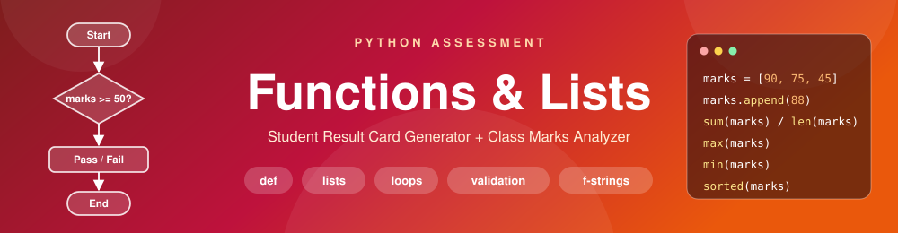
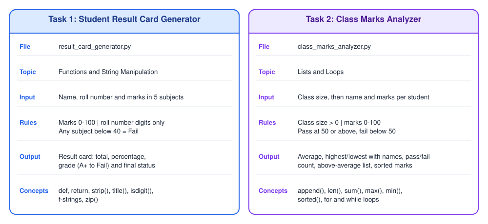
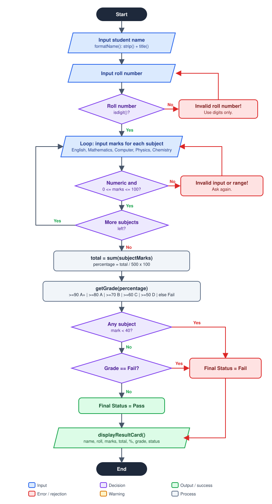
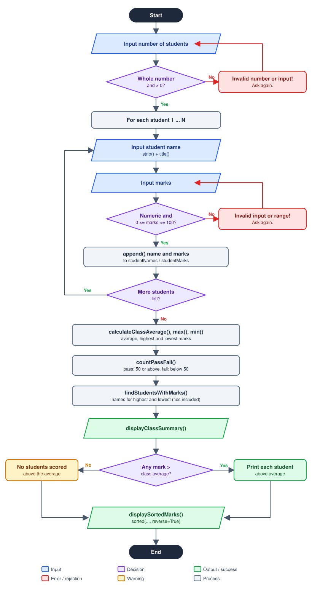
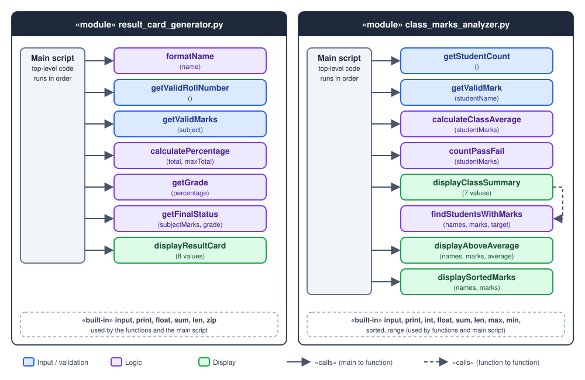

<p align="center"></p>

<p align="center"><b>Rendered README preview (light and dark mode):</b> <a href="https://claude.ai/artifact/N59wiSk9dwzbFuoxcVM9hV">https://claude.ai/artifact/N59wiSk9dwzbFuoxcVM9hV</a></p>

## 1. Project Overview

A beginner-friendly Python assessment with two separate console programs. Each runs on its own and uses only the standard library.

| Task | File | Topic |
|---|---|---|
| 1. Student Result Card Generator | `result_card_generator.py` | Functions (`def`, parameters, `return`) and string manipulation |
| 2. Class Marks Analyzer | `class_marks_analyzer.py` | Lists, list methods and loops |

<p align="center"></p>

## 2. Folder Structure

```text
python-functions-lists-assessment/
├── assets/
│   ├── banner.svg
│   ├── overview.svg
│   ├── result_card_flow.svg
│   ├── class_marks_flow.svg
│   └── uml_diagram.svg
├── result_card_generator.py
├── class_marks_analyzer.py
└── README.md
```

`assets/` only holds the README images. The three files required by the brief are in the repository root.

## 3. Task 1: Student Result Card Generator

**Summary.** `result_card_generator.py` reads a student's name, roll number and marks in five subjects (English, Mathematics, Computer, Physics, Chemistry). It cleans the name, validates the input, calculates the total and percentage, assigns a grade, applies the minimum-marks rule and prints a formatted result card.

**Rules**

- Marks must be between 0 and 100.
- The roll number must contain digits only (`.isdigit()`).
- The name is cleaned with `.strip()` and `.title()`.
- Grades: 90+ = A+, 80-89 = A, 70-79 = B, 60-69 = C, 50-59 = D, below 50 = Fail.
- If any subject mark is below 40, the final status is **Fail**, whatever the percentage.

### Program Flow

<p align="center"></p>

### Code Methods Description

| Method or section | Purpose |
|---|---|
| `getValidMarks(subject)` | Asks for marks until a number from 0 to 100 is entered |
| `getValidRollNumber()` | Asks for the roll number until it contains digits only |
| `calculatePercentage(total, maxTotal)` | Returns `total / maxTotal * 100` |
| `getGrade(percentage)` | Returns the letter grade with an `if / elif` chain |
| `formatName(name)` | Returns the name with `strip()` and `title()` applied |
| `getFinalStatus(subjectMarks, grade)` | Returns `Fail` if any mark is below 40 or the grade is `Fail`, otherwise `Pass` |
| `displayResultCard(...)` | Prints the result card with f-strings, pairing subjects and marks with `zip()` |
| Main script | Collects the input, calls the functions in order and prints the card |

### Input Validation

- **Marks:** a `try / except ValueError` block rejects text, and a range check rejects values outside 0-100. The program prints a message and asks again.
- **Roll number:** `.isdigit()` rejects letters, symbols, negative signs and empty input. The roll number is kept as text.
- **Name:** only cleaned with `strip()` and `title()`; its content is not checked.

### Expected Results

- A result card with name, roll number, five subject marks, total out of 500, percentage (2 decimals), grade and final status.
- A student with every mark at 40 or above is graded by percentage and passes when the grade is not `Fail`.
- A student with any mark below 40 always gets **Final Status: Fail**, even with a high percentage.

## 4. Task 2: Class Marks Analyzer

**Summary.** `class_marks_analyzer.py` asks for the class size, then a name and marks for every student. The names and marks are stored in two parallel lists and used to summarise the class performance.

**Rules**

- The class size must be a whole number greater than 0.
- Marks must be between 0 and 100.
- 50 or above passes, below 50 fails.
- The highest and lowest marks list every student who achieved them, so ties are shown.

### Program Flow

<p align="center"></p>

### Code Methods Description

| Method or section | Purpose |
|---|---|
| `getStudentCount()` | Asks for the class size until a whole number greater than 0 is entered |
| `getValidMark(studentName)` | Asks for one student's marks until a number from 0 to 100 is entered |
| `calculateClassAverage(studentMarks)` | Returns `sum(studentMarks) / len(studentMarks)` |
| `findStudentsWithMarks(studentNames, studentMarks, targetMarks)` | Returns the names of every student with exactly the target marks |
| `countPassFail(studentMarks)` | Returns the number of passing (50 or above) and failing students |
| `displayAboveAverage(...)` | Prints the students above the average, or a message if there are none |
| `displaySortedMarks(...)` | Prints each student and marks from highest to lowest using `sorted()` |
| `displayClassSummary(...)` | Prints average, highest and lowest marks with names, and the pass and fail counts |
| Main script | Fills `studentNames` and `studentMarks` with `append()`, then calls the functions |

### Input Validation

- **Class size:** `int()` inside `try / except ValueError` rejects text and decimals such as `2.5`. Zero and negative numbers are rejected by the `> 0` check.
- **Marks:** text is rejected by `try / except ValueError`, and values outside 0-100 are rejected by the range check.
- **Name:** only cleaned with `strip()` and `title()`; its content is not checked.

### Expected Results

- A summary with the class average, highest and lowest marks (with names), and the passing and failing counts.
- A list of students above the average, or `No students scored above the class average.`
- All students with their marks from highest to lowest.

## 5. UML Diagram

I chose a **module diagram** because both programs are procedural: they contain no classes, only functions and top-level script code in two files. Arrows show which code calls which function.

<p align="center"></p>

## 6. Concepts and Techniques Used

- User-defined functions (`def`) with parameters and return values
- Lists and list methods: `append()`, `len()`
- Built-in functions: `sum()`, `max()`, `min()`, `sorted()`, `range()`, `zip()`
- `for` and `while` loops
- `if`, `elif` and `else` decisions
- Input validation with `try` and `except ValueError`
- String methods: `strip()`, `title()`, `isdigit()`
- f-strings and formatted output (`:.2f`, `:<20`, `:>6.2f`)
- Tuple return values (`countPassFail`)

## 7. How to Run

**Requirements:** Python 3 and a terminal, PowerShell or VS Code. No extra packages are needed.

```bash
git clone https://github.com/Syedamaheen05/python-functions-lists-assessment.git
cd python-functions-lists-assessment
```

Run the Result Card Generator:

```bash
python result_card_generator.py
```

Run the Class Marks Analyzer:

```bash
python class_marks_analyzer.py
```

Alternative commands: use `python3 result_card_generator.py` and `python3 class_marks_analyzer.py` on macOS and Linux, or `py result_card_generator.py` and `py class_marks_analyzer.py` on Windows.

## 8. Sample Execution

All outputs below are copied from real runs of the programs.

### Task 1: Student Result Card Generator

**Success: normal input with a messy name**

```text
==== Student Result Card Generator ====
Enter student name:   maheen bukhari 
Enter roll number: 12345
Enter marks for English (0-100): 92
Enter marks for Mathematics (0-100): 85
Enter marks for Computer (0-100): 95
Enter marks for Physics (0-100): 78
Enter marks for Chemistry (0-100): 88

==========================================
           STUDENT RESULT CARD
==========================================
Student Name : Maheen Bukhari
Roll Number : 12345
------------------------------------------
English              :  92.00
Mathematics          :  85.00
Computer             :  95.00
Physics              :  78.00
Chemistry            :  88.00
------------------------------------------
Total Marks : 438.00 / 500
Percentage : 87.60%
Grade      : A
Final Status: Pass
==========================================
```

**Edge case: high percentage but one mark below 40**

```text
==== Student Result Card Generator ====
Enter student name: hina
Enter roll number: 404
Enter marks for English (0-100): 39
Enter marks for Mathematics (0-100): 100
Enter marks for Computer (0-100): 100
Enter marks for Physics (0-100): 100
Enter marks for Chemistry (0-100): 100

==========================================
           STUDENT RESULT CARD
==========================================
Student Name : Hina
Roll Number : 404
------------------------------------------
English              :  39.00
Mathematics          : 100.00
Computer             : 100.00
Physics              : 100.00
Chemistry            : 100.00
------------------------------------------
Total Marks : 439.00 / 500
Percentage : 87.80%
Grade      : A
Final Status: Fail
==========================================
```

**Invalid inputs are rejected and asked again**

```text
==== Student Result Card Generator ====
Enter student name: usman
Enter roll number: 12a
Invalid roll number! Use digits only.
Enter roll number: 
Invalid roll number! Use digits only.
Enter roll number: -5
Invalid roll number! Use digits only.
Enter roll number: 909
Enter marks for English (0-100): abc
Invalid input! Please enter numeric marks.
Enter marks for English (0-100): 101
Invalid marks! Enter a value between 0 and 100.
Enter marks for English (0-100): -1
Invalid marks! Enter a value between 0 and 100.
Enter marks for English (0-100): 80
Enter marks for Mathematics (0-100): 70
Enter marks for Computer (0-100): xyz
Invalid input! Please enter numeric marks.
Enter marks for Computer (0-100): 75.5
Enter marks for Physics (0-100): 60
Enter marks for Chemistry (0-100): 65

==========================================
           STUDENT RESULT CARD
==========================================
Student Name : Usman
Roll Number : 909
------------------------------------------
English              :  80.00
Mathematics          :  70.00
Computer             :  75.50
Physics              :  60.00
Chemistry            :  65.00
------------------------------------------
Total Marks : 350.50 / 500
Percentage : 70.10%
Grade      : B
Final Status: Pass
==========================================
```

### Task 2: Class Marks Analyzer

**Success: three students**

```text
==== Class Marks Analyzer ====
Enter number of students in class: 3

Student 1
Enter student name: ali
Enter marks for Ali (0-100): 75

Student 2
Enter student name: sara
Enter marks for Sara (0-100): 90

Student 3
Enter student name: ahmed
Enter marks for Ahmed (0-100): 45

==========================================
          CLASS MARKS ANALYSIS
==========================================
Class Average    : 70.00
Highest Marks    : 90.00
Achieved by      : Sara
Lowest Marks     : 45.00
Achieved by      : Ahmed
Passing Students : 2
Failing Students : 1
==========================================

Students scoring above class average:
Ali: 75.00
Sara: 90.00

Student marks sorted from highest to lowest:
Sara: 90.00
Ali: 75.00
Ahmed: 45.00
```

**Edge case: ties for highest and lowest marks**

```text
==== Class Marks Analyzer ====
Enter number of students in class: 4

Student 1
Enter student name: ali
Enter marks for Ali (0-100): 80

Student 2
Enter student name: sara
Enter marks for Sara (0-100): 80

Student 3
Enter student name: zain
Enter marks for Zain (0-100): 50

Student 4
Enter student name: hina
Enter marks for Hina (0-100): 50

==========================================
          CLASS MARKS ANALYSIS
==========================================
Class Average    : 65.00
Highest Marks    : 80.00
Achieved by      : Ali, Sara
Lowest Marks     : 50.00
Achieved by      : Zain, Hina
Passing Students : 4
Failing Students : 0
==========================================

Students scoring above class average:
Ali: 80.00
Sara: 80.00

Student marks sorted from highest to lowest:
Ali: 80.00
Sara: 80.00
Zain: 50.00
Hina: 50.00
```

**Edge case: everyone has the same marks**

```text
==== Class Marks Analyzer ====
Enter number of students in class: 3

Student 1
Enter student name: ali
Enter marks for Ali (0-100): 60

Student 2
Enter student name: sara
Enter marks for Sara (0-100): 60

Student 3
Enter student name: zain
Enter marks for Zain (0-100): 60

==========================================
          CLASS MARKS ANALYSIS
==========================================
Class Average    : 60.00
Highest Marks    : 60.00
Achieved by      : Ali, Sara, Zain
Lowest Marks     : 60.00
Achieved by      : Ali, Sara, Zain
Passing Students : 3
Failing Students : 0
==========================================

Students scoring above class average:
No students scored above the class average.

Student marks sorted from highest to lowest:
Ali: 60.00
Sara: 60.00
Zain: 60.00
```

**Invalid class size and invalid marks are rejected**

```text
==== Class Marks Analyzer ====
Enter number of students in class: 0
Invalid number! Enter at least one student.
Enter number of students in class: -2
Invalid number! Enter at least one student.
Enter number of students in class: abc
Invalid input! Enter a whole number.
Enter number of students in class: 2.5
Invalid input! Enter a whole number.
Enter number of students in class: 2

Student 1
Enter student name:   zara khan 
Enter marks for Zara Khan (0-100): 101
Invalid marks! Enter a value between 0 and 100.
Enter marks for Zara Khan (0-100): -1
Invalid marks! Enter a value between 0 and 100.
Enter marks for Zara Khan (0-100): abc
Invalid input! Please enter numeric marks.
Enter marks for Zara Khan (0-100): 88

Student 2
Enter student name: ali
Enter marks for Ali (0-100): 64

==========================================
          CLASS MARKS ANALYSIS
==========================================
Class Average    : 76.00
Highest Marks    : 88.00
Achieved by      : Zara Khan
Lowest Marks     : 64.00
Achieved by      : Ali
Passing Students : 2
Failing Students : 0
==========================================

Students scoring above class average:
Zara Khan: 88.00

Student marks sorted from highest to lowest:
Zara Khan: 88.00
Ali: 64.00
```

## 9. Test Cases

Every case below was run against the final code.

### Task 1: Student Result Card Generator

| # | Scenario | Inputs | Expected result |
|---|---|---|---|
| 1 | Normal pass, messy name | `  maheen bukhari `, `12345`, marks 92, 85, 95, 78, 88 | `Maheen Bukhari`, 438.00 / 500, 87.60%, A, Pass |
| 2 | Exactly 90% | roll `101`, all marks 90 | 90.00%, A+, Pass |
| 3 | Exactly 50% | roll `202`, all marks 50 | 50.00%, D, Pass |
| 4 | Just below 50% | roll `303`, all marks 49 | 49.00%, Fail, Fail |
| 5 | One mark below 40, high percentage | roll `404`, marks 39, 100, 100, 100, 100 | 87.80%, A, **Fail** |
| 6 | Lowest mark exactly 40 | roll `505`, marks 40, 90, 90, 90, 90 | 80.00%, A, Pass |
| 7 | Several failures together | roll `606`, marks 30, 35, 60, 70, 20 | 43.00%, Fail, Fail |
| 8 | All zeros | roll `707`, all marks 0 | 0.00%, Fail, Fail |
| 9 | Decimal marks | roll `808`, marks 79.5, 80, 80, 80, 80 | 399.50 / 500, 79.90%, B, Pass |
| 10 | Invalid inputs | roll `12a`, empty, `-5`, then `909`; marks `abc`, `101`, `-1`, then 80; `xyz`, then 75.5 | Each bad value rejected with a message; card shows 350.50 / 500, 70.10%, B, Pass |

### Task 2: Class Marks Analyzer

| # | Scenario | Inputs | Expected result |
|---|---|---|---|
| 1 | Normal class | 3 students: Ali 75, Sara 90, Ahmed 45 | Average 70.00; highest Sara; lowest Ahmed; 2 pass, 1 fail; above average: Ali, Sara |
| 2 | Ties | 4 students: Ali 80, Sara 80, Zain 50, Hina 50 | Average 65.00; highest Ali, Sara; lowest Zain, Hina; 4 pass, 0 fail |
| 3 | All marks equal | 3 students, all 60 | Average 60.00; all three listed for highest and lowest; no one above average |
| 4 | Single student | 1 student: Ali 72.5 | Average, highest and lowest all 72.50; no one above average |
| 5 | Pass boundary | Ali 50, Sara 49.99 | 1 pass, 1 fail; average 50.00; Ali above average |
| 6 | Extreme marks | Ali 100, Sara 0 | Average 50.00; highest 100.00; lowest 0.00; 1 pass, 1 fail |
| 7 | All failing | Ali 10, Sara 20, Zain 30 | 0 pass, 3 fail; average 20.00; Zain above average |
| 8 | Invalid inputs | class size `0`, `-2`, `abc`, `2.5`, then `2`; marks `101`, `-1`, `abc`, then 88; second student Ali 64 | Each bad value rejected with a message; average 76.00; highest Zara Khan, lowest Ali |

---

<p align="center"><b>Author:</b> <a href="https://github.com/Syedamaheen05">Syyeda Maheen Bukhari</a> | GitHub: <a href="https://github.com/Syedamaheen05">@Syedamaheen05</a></p>
